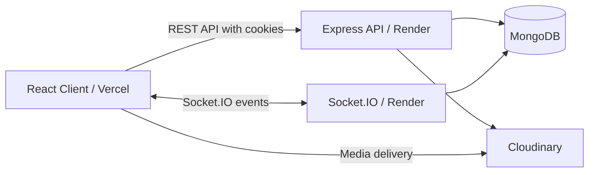

# ChatBuddy

Real-time conversations, friend connections, and group messaging built with MongoDB, Express, React, Node.js, and Socket.IO.

**[Open Live Demo](https://your-chatbuddy.vercel.app/)** | [Source Code](https://github.com/AdityaGoel0320/MERN-CHAT-APP-WITH-SOCKET-IO)

The React client is deployed on **Vercel**, with the API and Socket.IO server on **Render**. The free-tier backend may sleep between visits, so the first connection can take approximately 30-60 seconds.

## Features

- **Direct and group conversations:** persistent message history, typing indicators, online presence, and unread-message alerts.
- **Friend connections:** discover people, send requests, and accept or decline incoming requests. Search excludes your own account and existing direct-chat members.
- **Group management:** create groups, manage membership, rename conversations, and leave groups.
- **Media sharing:** upload attachments through Cloudinary and render supported media within conversations.
- **Account security:** password hashing, unique usernames, JWT authentication in HTTP-only cookies, and server-side conversation membership checks.
- **Responsive workspace:** mobile conversation navigation, light and dark themes, animated authentication screens, and profile-photo cropping during signup.
- **Administration:** dedicated dashboard and management views for users, chats, and messages.

## Architecture



Express and Socket.IO share the same HTTP server. REST endpoints handle authentication, discovery, requests, group operations, and attachments; socket handlers deliver real-time messages, typing events, and presence updates.

### Engineering Decisions

- **Persist before broadcast:** socket messages are saved to MongoDB before being emitted to conversation members. Acknowledgements report success or failure to the sender.
- **Authorize on the server:** message and typing handlers check database membership rather than trusting a client-supplied recipient list.
- **Separate UI and server state:** Redux slices track authentication and workspace state; RTK Query manages API data, caching, and tag-based invalidation, including friend-request notifications.
- **Support multiple tabs:** presence tracks a set of socket connections per user, so closing one tab does not immediately mark another active tab offline.
- **Verify the session:** login and signup check the authenticated profile endpoint before opening the workspace, rather than assuming a successful response means the browser retained the cookie.

## Tech Stack

| Layer                | Technologies                                     |
| -------------------- | ------------------------------------------------ |
| Client               | React 18, Vite 5, React Router 6                 |
| State and data       | Redux Toolkit, RTK Query, Axios                  |
| Interface            | Material UI, Tailwind CSS, Framer Motion, Lucide |
| Server               | Node.js, Express 4, Socket.IO 4                  |
| Persistence          | MongoDB, Mongoose 8                              |
| Authentication       | JSON Web Tokens, bcrypt, HTTP-only cookies       |
| Media                | Multer, Cloudinary, react-easy-crop              |
| Validation and tests | express-validator, Node.js test runner           |

## Project Structure

```text
backend/
  app.js                 Express and Socket.IO entry point
  backendConstant.js     Allowed frontend origin
  controllers/           HTTP request handlers
  lib/                   Socket handlers, validation, and socket tests
  middlewares/           Authentication, uploads, and error handling
  models/                User, chat, message, and request schemas
  routes/                User, chat, and admin API routes
  utils/                 Cookies, database connection, and media utilities
frontend/
  src/
    components/          Layouts, dialogs, shared UI, and profile views
    constants/           Backend URL and shared event names
    pages/               Authentication, conversations, groups, and admin
    redux/               API endpoints, reducers, and store
    socket.jsx           Socket.IO connection provider
  vercel.json            Single-page application route rewrites
```

## Local Development

### Prerequisites

- Node.js 22 and npm.
- A local MongoDB instance or a MongoDB Atlas connection string.
- A Cloudinary account for profile photos and attachments.

### 1. Install Dependencies

Run from the repository root:

```bash
git clone https://github.com/AdityaGoel0320/MERN-CHAT-APP-WITH-SOCKET-IO.git
cd MERN-CHAT-APP-WITH-SOCKET-IO
npm install
npm --prefix backend install
npm --prefix frontend install
```

### Automatic Formatting

The root `npm install` activates the Husky pre-commit hook. Every commit runs
Prettier across the repository, then lint-staged formats and re-stages only the
files already selected for the commit. Unstaged work stays unstaged, including
formatting changes to files outside the commit. Formatting failures block the
commit.

Run `npm run format` to format manually or `npm run format:check` to check without
changing files. Dependencies, build output, lockfiles, and environment files are
excluded.

### 2. Configure the Backend

Create a `.env` file inside the `backend` directory:

```dotenv
PORT=1111
NODE_ENV=development
MONGO_URI=mongodb://127.0.0.1:27017/DB_of_your_choice
JWT_SECRET=replace-with-a-long-random-secret
ADMIN_SECRET_KEY=replace-with-a-different-long-random-secret
CLOUDINARY_CLOUD_NAME=your-cloud-name
CLOUDINARY_API_KEY=your-api-key
CLOUDINARY_API_SECRET=your-api-secret
```

For Atlas, replace `MONGO_URI` with your own connection string and configure network access. The connection helper explicitly selects the database name `DB_of_your_choice`.

Keep credentials out of source control. Use distinct JWT and admin secrets; never expose backend secrets through frontend configuration.

### 3. Align the Client and Server URLs

The current implementation uses source constants, not `CLIENT_URL` or `VITE_SERVER` environment variables.

In [backend/backendConstant.js](backend/backendConstant.js), set the exact frontend origin:

```js
const frontendUrl = "http://localhost:5173";

export { frontendUrl };
```

In [frontend/src/constants/frontendConstant.js](frontend/src/constants/frontendConstant.js), set the backend URL:

```js
export const server = "http://localhost:1111";
```

Use the port Vite actually reports. If it selects `5174` or another port, update `frontendUrl` accordingly. Keep `localhost` consistent across both URLs, omit trailing slashes, and do not use a wildcard CORS origin with cookie authentication.

### 4. Start Both Services

Backend terminal, starting from the repository root:

```bash
cd backend
npm run backend
```

Frontend terminal, starting from the repository root:

```bash
cd frontend
npm run dev
```

Open the frontend URL printed by Vite. Run only one backend instance per port. For backend execution without nodemon, use `npm start` from the backend directory.

### 5. Try the Messaging Flow

Create two accounts in separate browser profiles, send a friend request from one account, accept it from the other, and open the resulting conversation. Separate profiles avoid sharing the same session cookie between accounts.

## Deployment

| Setting          | Frontend                            | Backend                               |
| ---------------- | ----------------------------------- | ------------------------------------- |
| Platform         | Vercel                              | Render web service                    |
| Root directory   | `frontend`                          | `backend`                             |
| Install command  | `npm install`                       | `npm install`                         |
| Build command    | `npm run build`                     | Not required                          |
| Output directory | `dist`                              | Not applicable                        |
| Start command    | Managed by Vercel                   | `npm start`                           |
| Public URL       | `https://your-chatbuddy.vercel.app` | `https://chatbuddy-ywot.onrender.com` |

Before deploying:

1. Set `frontendUrl` to `https://your-chatbuddy.vercel.app` and `server` to `https://chatbuddy-ywot.onrender.com` in the configuration files above.
2. Configure MongoDB, Cloudinary, JWT, and admin environment variables on Render. Set `NODE_ENV=production`; the server also accepts the platform-provided `PORT`.
3. Keep the backend on a service that supports long-lived Socket.IO connections. The Vercel deployment serves the frontend only.
4. Deploy both services together when changing API contracts or socket event payloads.
5. Sign in again after authentication changes, then verify requests, messaging, media uploads, and logout using the deployed origins.

### Authentication Across Origins

The Vercel frontend and Render backend are separate sites. Requests must include credentials, and the backend must allow the exact frontend origin. HTTPS deployments use `Secure`, `HttpOnly`, `SameSite=None`, and partitioned session cookies. Browser support and privacy settings can still affect cross-site cookies; a successful login response alone is not proof of a persisted session.

## Verification

Run these commands from the repository root:

| Command                           | Purpose                                                        |
| --------------------------------- | -------------------------------------------------------------- |
| `npm --prefix backend test`       | Run isolated socket-handler tests using in-memory dependencies |
| `npm --prefix frontend run build` | Compile the production frontend                                |
| `npm --prefix frontend run lint`  | Run the frontend ESLint checks                                 |

Socket tests do not require MongoDB or Cloudinary. Full signup, cross-account messaging, uploads, and deployed-cookie verification require configured services and browser testing. A successful build does not imply a clean lint report; the frontend has existing prop-validation and unused-import lint issues.

## Operational Notes

| Symptom                                            | Check                                                                                                                                            |
| -------------------------------------------------- | ------------------------------------------------------------------------------------------------------------------------------------------------ |
| Slow first connection                              | The free-tier Render service may be waking up. Allow time for the initial request.                                                               |
| `EADDRINUSE`                                       | Another process already owns the backend port. Stop the duplicate instance rather than launching more servers.                                   |
| Login succeeds but protected requests return `401` | Check cookie storage, the exact allowed frontend origin, HTTPS settings, and whether both deployments include the latest authentication changes. |
| CORS errors during local development               | Set `frontendUrl` to the actual local frontend origin, not the deployed Vercel URL.                                                              |
| MongoDB connection failure                         | Check `MONGO_URI`, Atlas network access, and DNS connectivity. Start the backend from its own directory so its `.env` file loads.                |
| Missing media or failed uploads                    | Check Cloudinary configuration and upload restrictions.                                                                                          |

### Current Boundaries

- Presence and user-to-socket mappings live in one server process. Multiple backend replicas would require a shared Socket.IO adapter and a distributed presence strategy.
- Socket acknowledgements provide request feedback, not an exactly-once delivery guarantee.
- Automated coverage is focused on socket handlers; it does not replace end-to-end or production deployment tests.
- Review dependency advisories separately before deployment; compilation and unit tests are not a security audit.

## Screenshots

These screenshots capture earlier versions of the interface; the current deployment includes updated themes and layouts.

<details>
<summary>Messaging Workspace</summary>


</details>

<details>
<summary>Admin Dashboard</summary>


</details>

<details>
<summary>Group Management</summary>


</details>

## Author

**Aditya Goel**

[Portfolio](https://aditya-goel-portfolio-website.vercel.app/) | [GitHub](https://github.com/AdityaGoel0320) | [LinkedIn](https://www.linkedin.com/in/aditya-goel-286245239/)
